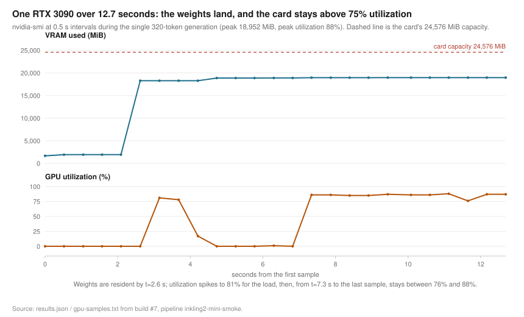

# Inkling 2 Mini runs at 51 tok/s on a 24 GB 3090 through Unsloth's llama.cpp, and not at all through Ollama

*Status: smoke-tested, N=1. A 16.4 GiB UD-Q4_K_XL conversion of Inkling 2 Mini loads fully onto one RTX 3090 and decodes 320 tokens at 51.18 tok/s out of 18,952 MiB of VRAM; the same weights are refused outright by the lab's Ollama 0.40.16, which does not know the architecture.*

## The question

Thinking Machines' launch post for Inkling 2 Mini describes "a looped transformer, running the middle layers of the model three times for every token" — a mixture-of-experts with 26.4 B total parameters, 3.4 B active, 5.4 B weight activations per token once looping is counted, most weights in NVFP4 and the last four layers in MXFP8, at a total footprint of about 20 GB.

The post names three local-inference paths: "any Mac system (MacBook, Mac Mini) with at least 32GB RAM via Ollama", NVIDIA's DGX Spark for native NVFP4, and "quantized GGUF versions ... available via Unsloth and llama.cpp for local inference". Ollama, SGLang, vLLM and Unsloth all appear in the supported-framework list; only the Mac path carries a stated memory floor for Ollama.

The lab's inference box is a single RTX 3090 at 24 GB with a shared Ollama daemon. That turns the launch into two narrow hardware questions, neither of them about model quality:

1. Does a GGUF conversion of Inkling 2 Mini load and generate on a 24 GB Ampere card, when the only desktop box named in the launch post is NVIDIA's DGX Spark and the only documented Ollama path is Apple silicon with 32 GB of unified memory?
2. Does the already-deployed Ollama daemon serve it?

A transformer that runs its middle layers three times has to carry per-pass state, so the existence of a GGUF file is not evidence that any given engine can load the architecture. Both questions are settled by attempting an execution and reading the engine's own logs.

## Method

Two arms, one prompt, one generation each. N=1; the unit of evidence is one completed HTTP generation plus the engine's own timing output.

**Arm A — llama.cpp from a prebuilt CUDA bundle.**

- **Model.** `unsloth/Inkling-2-Mini-GGUF` at revision `ae9327c5fbc7333116ba32eee78bb5d2bbefae4f`, file `Inkling-2-Mini-UD-Q4_K_XL.gguf`, 17,629,759,456 bytes (16.42 GiB), SHA-256 `e62d463c…de15`, re-verified against the digest after download inside the task.
- **Runtime.** `unslothai/llama.cpp` release `b12588-mix-c0c3de8`, asset `app-b12588-mix-c0c3de8-linux-x64-cuda12-portable.tar.gz`, SHA-256 `4c30d5e3…5980`, self-reporting `version: 1.0.0-dev (build 12588, commit 883286076)`. It is a portable CUDA 12 build that loads ggml backends dynamically, so the CUDA runtime comes from the container.
- **Container.** `pytorch/pytorch:2.9.1-cuda12.8-cudnn9-runtime`, pinned by image digest `sha256:7b324d21…1385`. `libcudart.so.12`, `libcublas.so.12` and `libcublasLt.so.12` resolve, with zero unresolved objects on `libggml-cuda`.
- **Server flags.** `--ctx-size 4096 --n-gpu-layers 999 --threads 8 --parallel 1 --seed 42 --temp 0.2 --no-webui --metrics`.

**Arm B — the shared Ollama daemon.** Version 0.40.16, asked over HTTP at the docker-bridge address for `hf.co/unsloth/Inkling-2-Mini-GGUF:UD-Q4_K_XL` with `keep_alive=0`, so the model unloads again before arm A starts and cannot contaminate its VRAM measurement. The daemon is treated as read-only: this arm probes the deployed version, it does not modify it.

**Held constant.** The prompt, the 320-token cap, one slot, eight threads, and the card itself. Both arms run inside a single Concourse task that holds the lab's `gpu-lock`, so nothing else can occupy the GPU; the 16.4 GiB download and hash verification happen in the same task's lock-free prepare phase, because a two-hour download has no business holding the lock.

Both arms receive the same prompt:

> In two sentences, explain why a graphics card's memory bandwidth matters more than its raw FLOPs when generating tokens from a large language model.

**Why a prebuilt bundle rather than the source build the survey pinned.** The compatibility survey ahead of the run pins a source build of the unmerged llama.cpp pull request that declares `inkling2` support, together with the IQ4_NL conversion. That path makes the compiler flags the only record of what the runtime does, and it depends on a diff that is not in a release. The prebuilt bundle fixes the runtime by digest, needs no compilation under the GPU lock, and ships a `BUILD_INFO` naming its source commit — so model and engine identity are both pinned by hash rather than by build recipe.

**Decision rule, fixed before the run.**

- **pass** — `llama-server` reports healthy, generation returns HTTP 200, the `content` channel is non-empty and on-topic, and the VRAM sampler shows the weights resident (≥15 GiB) with non-zero utilization while decoding.
- **incompatible** — the engine refuses the file with an architecture or parse error. That is a finding about support, not a harness failure.
- **indeterminate** — no HTTP response, or a generation with an empty `content` channel. A harness fault says nothing about the model.
- **Ollama arm** — any 2xx generation counts as support; an HTTP error whose body names the architecture is a support finding; a timeout is indeterminate.

**The null.** A card with no model loaded reads 1,667 MiB used and 0% utilization in the same instrument pair. VRAM comes from two independent instruments — a 0.5 s `nvidia-smi` poll inside the harness and a separate peak poll by the task wrapper — which agree here to 1 MiB (18,952 vs 18,951), so the repeatability floor of the measurement is below the effects being read.

## Results

| measurement | value |
| :-- | :-- |
| model | `Inkling-2-Mini-UD-Q4_K_XL.gguf`, 16.42 GiB, revision `ae9327c5` |
| quantisation | UD-Q4_K_XL GGUF, dynamic 4-bit, ~5.3 bits per weight on average |
| runtime | llama.cpp `b12588-mix-c0c3de8`, linux-x64-cuda12-portable |
| hardware | 1× NVIDIA GeForce RTX 3090, 24,576 MiB, sm_86, driver 595.99.02 |
| idle VRAM before load | 1,667 MiB used, 22,907 MiB free, 0% utilization |
| load to healthy | 6.5 s |
| prompt eval | 44 tokens in 485.93 ms — 11.04 ms/token, 90.55 tok/s |
| decode | 320 tokens in 6,232.70 ms — 19.54 ms/token, **51.18 tok/s** |
| generation wall clock | 6.73 s, HTTP 200 |
| peak VRAM | 18,952 MiB — 77% of the card, +17,285 MiB over idle |
| peak utilization | 88% |
| VRAM after shutdown | 1,677 MiB, back to the idle baseline |
| task exit status | 0; GPU task wall 22 s, under a 30 min timeout |
| Ollama arm | HTTP 500 after 3.3 s — `unknown model architecture: 'inkling2'` |

<figure>
  
  <figcaption>The harness's own 0.5 s samples across the run: the weights land between t=2.6 s and t=3.1 s, and the card holds 76-88% utilization through decode. Peak 18,952 MiB of 24,576 MiB.</figcaption>
</figure>

The generated text, verbatim, from the `content` channel:

```
During autoregressive decoding, each new token mostly requires streaming the model weights and KV cache from GPU memory rather than doing dense arithmetic, so arithmetic intensity is low and compute units sit idle. Consequently, tokens/sec is capped by memory bandwidth and capacity, while raw FLOPs mainly help compute-bound phases like prefill and training, not single-
```

The model is a reasoning model: it wrote a plan into a separate `reasoning_content` channel before answering, and the 320-token cap cut the visible answer mid-word at `single-`. The reasoning channel contains the intended second sentence in full — "not single-token generation" — and is captured with the rest of the evidence.

The Ollama arm, verbatim from the daemon:

```
llama-server process has terminated: exit status 1:
error: Failed to load CLIP model from /usr/share/ollama/.ollama/models/blobs/sha256-2c165c78…
error loading model: unknown model architecture: 'inkling2'
error loading model: unknown model architecture: 'inkling2'
```

## A real generation, and a real refusal

Read out, the two arms say different things.

**The 3090 is enough card for the deployed path.** The vendor's stated Ollama floor is 32 GB of unified memory and its only named GPU at launch is the DGX Spark, yet a 4-bit GGUF of the same model runs inside 18,952 MiB — 77% of a 24 GB card, with 5,624 MiB of headroom at 4,096 tokens of context. Nothing in the release notes prepares a reader for that; the GGUF path via llama.cpp is named in the launch post, and llama.cpp is what makes the card sufficient.

**51 tok/s is a floor, not a roof.** With the vendor's own 5.4 B weight activations per token and ~5.3 bits per weight, one decoded token streams on the order of 3.6 GB, which at 19.54 ms/token is roughly 184 GB/s — about 20% of the card's 936 GB/s spec. That arithmetic is not a measurement, but it rules out the obvious explanation: at batch 1 and one slot this run is not bandwidth-limited, and there is room on the card that a single stream does not use. Read it as what one 3090 does at concurrency 1, not as the model's ceiling.

**The Ollama failure is about the engine's version, not the hardware.** The daemon's error names the architecture twice and separately fails to load a CLIP blob, which describes an engine built before the architecture existed rather than a card that cannot hold it: 0.40.16 has no `inkling2` architecture in it, and the launch only advertises Ollama on Mac at 32 GB+. The honest summary is that the most-advertised local path in the announcement is the one that does not work on the lab's hardware today, for a reason a newer engine release could remove — and that no part of this run tests whether a newer one does.

**Both arms were given identical weights.** Same repository, same revision, same file. The difference between 51.18 tok/s and HTTP 500 is the engine on the other end, not the model.

## What this does not settle

- **One prompt, one seed, one run.** Nothing here speaks to quality, instruction-following, reliability across prompts, or behaviour outside a single 4,096-token window. A second prompt would not make this a benchmark; a decision about whether to use the model would.
- **The answer was truncated.** The `content` channel stops mid-word at the 320-token cap because the model spent most of its budget on a reasoning channel. "Coherent output" here means the visible text is on-topic and technically correct up to the cut, not that a complete answer was delivered. Any harness that reads only the content channel must budget for the reasoning preamble or it will ship half-sentences.
- **Degeneracy is not correctness.** The text has a distinct-word ratio of 0.909, which rules out repetition loops and nothing else. No reference answer, no judge, no second opinion from another model.
- **A single quantisation.** No IQ4_NL (the conversion the survey pinned), no Q8_0, no NVFP4 — that last one needs Blackwell and is what the vendor actually trains in. The 51 tok/s figure is specific to UD-Q4_K_XL.
- **Context is short.** 4,096 tokens with a 44-token prompt. Per-pass state for the three-times-looped middle layers at long context, and the KV-cache behaviour that follows from it, are unmeasured. Whether 18,952 MiB leaves room for a materially larger context on this card is untested.
- **Ollama 0.40.16 is the deployed version, not the current one.** Whether a newer release loads `inkling2` is unknown here; the shared daemon was deliberately left alone. The Mac-side 32 GB claim in the launch post is likewise untested on this hardware.
- **Concurrency and prefill are untested.** One slot, `--parallel 1`, a 44-token prompt. Prompt processing came in at 90.55 tok/s on that single request, which describes almost no real workload.

## Cost

- **Compute to output.** 6.23 s of decode for 320 tokens, 19.54 ms per token. Loading 16.4 GiB from disk to a healthy server costs 6.5 s, and the whole GPU task — Ollama probe, load, generation, sampling, shutdown — is **22 s** of wall clock and 22 s of held `gpu-lock`.
- **Peak memory.** 18,952 MiB of 24,576 MiB: 77% of the RTX 3090, 17,285 MiB above the 1,667 MiB idle baseline, back to 1,677 MiB after shutdown.
- **Calendar time from the ask: 21 hours 38 minutes.** The task was filed on 2026-11-20 at 13:25 PST and build #7 passed on 2026-11-21 at 11:03 PST. The active build span is **1 h 47 m 38 s** (first build 09:15 PST). Of build #7's 24 m 25 s, 22 s is the GPU task; the rest is the 16.4 GiB hash-verified download and the image pull, all of it off-lock.
- **Failed builds leading to the pass** — six of them, none a model or runtime incompatibility:
  - **#1, 10m01s (aborted)** and **#2 (aborted, no recorded start):** the single-stream weight download crawls at ~2 MB/s, about two hours for 16.4 GiB. Replaced with 12 parallel byte ranges, concatenated and hash-verified.
  - **#3, 14m35s (failed):** `libgomp.so.1` is not on the loader path inside the PyTorch image — it lives in `/opt/conda/lib`. The fetch step now proves `llama-server --version` starts before the 16.4 GiB download begins.
  - **#4, 18m14s (failed):** harness bug — a relative program path combined with `cwd=` in `subprocess.Popen`.
  - **#5, 20m00s (failed):** harness bug — an `Event` shadowing `threading.Thread._stop`, so the response landed only on the reasoning channel and the harness raised. The engine itself ran at 51.19 tok/s, the same number the passing build reports.
  - **#6, 8m19s (aborted):** the server left behind by #5 still held 17.8 GiB. Cleanup was made exception-proof: `SIGTERM`, then `SIGKILL`, then a free-VRAM gate before the next run may start.

## Files

The evidence files are the contents of the task's egress archive, `s3://blades68-3d/inkling2-mini-smoke/telemetry-and-logs.tar.gz` (10 KiB, written 2026-11-21 11:03:32 PST, SHA-256 `06b1a6ad…79ca`), re-downloaded and byte-compared against the run directory before publication.

- [`inkling2_smoke.py`](files/2026-11-21-inkling2-mini-3090-smoke/inkling2_smoke.py) — the harness: both arms, the VRAM sampler, the timing capture, and the shutdown gates
- [`inkling2_fetch.sh`](files/2026-11-21-inkling2-mini-3090-smoke/inkling2_fetch.sh) — lock-free prepare step: parallel range download and SHA-256 verification of weights and runtime
- [`inkling2-mini-smoke.yml`](files/2026-11-21-inkling2-mini-3090-smoke/inkling2-mini-smoke.yml) — instance vars pinning image digest, model revision, runtime release and workload command
- [`gpu-workload-template.yml`](files/2026-11-21-inkling2-mini-3090-smoke/gpu-workload-template.yml) — the reusable Concourse workload template this pipeline is an instance of (lock, timeout, egress)
- [`results.json`](files/2026-11-21-inkling2-mini-3090-smoke/results.json) — every measurement: GPU state, CUDA library resolution, timings, VRAM samples, both arms, shutdown
- [`summary.md`](files/2026-11-21-inkling2-mini-3090-smoke/summary.md) — the harness's verdict table and generated text
- [`output.txt`](files/2026-11-21-inkling2-mini-3090-smoke/output.txt) — generated text split by channel, `content` versus `reasoning_content`
- [`server.log`](files/2026-11-21-inkling2-mini-3090-smoke/server.log) — `llama-server`'s own log including its `print_timing` lines
- [`ollama-arm.json`](files/2026-11-21-inkling2-mini-3090-smoke/ollama-arm.json) — the daemon's answer, verbatim, and proof the model unloaded again
- [`inkling2-toolchain.json`](files/2026-11-21-inkling2-mini-3090-smoke/inkling2-toolchain.json) — pinned model and runtime identity plus the vendor `BUILD_INFO`
- [`gpu-samples.txt`](files/2026-11-21-inkling2-mini-3090-smoke/gpu-samples.txt) — the raw 0.5 s VRAM and utilization samples behind the figure
- [`vram_utilization_chart.py`](files/2026-11-21-inkling2-mini-3090-smoke/vram_utilization_chart.py) — the script that turns those samples into the figure, unplotting nothing and smoothing nothing; it reproduces the published SVG byte for byte
- [`prepare.log`](files/2026-11-21-inkling2-mini-3090-smoke/prepare.log) — the lock-free preparation log, including the digest checks
