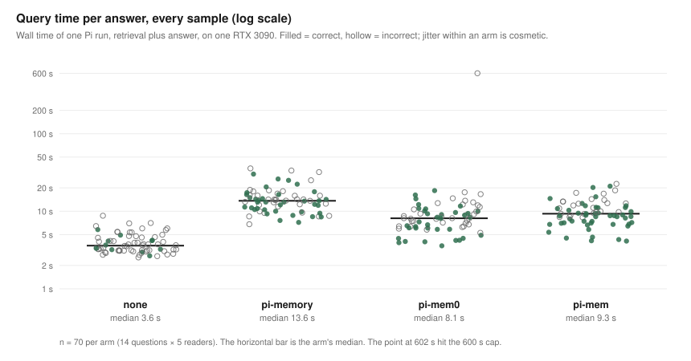

# pi-mem lifts every local reader to 79–93% on a LongMemEval-S pilot, and the choice of reader barely moves the score

*Status: complete pilot, N=14 questions × 4 memory arms × 5 local readers = 280 graded answers. Against memory snapshots written by one fixed model, pi-mem answers 59 of 70 pooled questions, pi-memory 36, pi-mem0 35, and no memory at all 11; within any one memory arm the five readers differ by at most two questions.*

## The question

Pi, the terminal coding agent, has no long-term memory of its own; it gets one from extensions. Three are installable today, and each stores something different: plain markdown notes with optional local search, compressed observations in a vector table, or extracted facts in a local Mem0 store. The lab also has five local models that fit fully on one RTX 3090: Thinking Machines' Inkling 2 Mini, three uncensored Inkling derivatives, and Qwen3.8-27B. The lab's planning note frames the full comparison as "5 models × 4 memory systems × 2 benchmarks … 40 experimental cells (50 if you include a `none` baseline)".

This report is the first slice of that matrix: LongMemEval-S only, at pilot size. It asks two narrow questions:

1. Over a fixed body of remembered history, does the memory extension change how many questions a local reader answers correctly?
2. With the memory extension held fixed, does the choice of local reader change it?

The second benchmark in the planning note, DolphinBench, is outside this report; the limitations section says why.

## Method

**Benchmark.** [LongMemEval-S](https://github.com/xiaowu0162/LongMemEval), cleaned release ([Hugging Face revision `98d7416c`](https://huggingface.co/datasets/xiaowu0162/longmemeval-cleaned), file SHA-256 `d6f21ea9…c3a442`). Each of its 500 questions arrives with its own haystack of past user–assistant chat sessions, 41 to 57 sessions for the questions used here, and a question date. The pilot takes two questions from each of seven strata: the six LongMemEval question types, plus abstention questions (IDs ending `_abs`, whose correct answer is that the history does not say) as a stratum of their own. Within a stratum, questions are ordered by the SHA-256 of their ID and the first two are taken, so the slice is fixed and reproducible: 14 questions.

**Memory arms.** Four, each a different Pi extension or none:

| Arm | Package | What it stores | Search |
|---|---|---|---|
| `none` | — | nothing | — |
| `pi-memory` | [`pi-memory` 0.4.2](https://github.com/jayzeng/pi-memory) | markdown files: long-term memory, daily logs, scratchpad | qmd 2.5.3 keyword or semantic search; `embeddinggemma-300M` on CPU |
| `pi-mem` | [`pi-mem` 0.1.0](https://github.com/georgebashi/pi-mem) | LLM-extracted observations and session summaries in LanceDB | full-text plus `nomic-embed-text` vectors |
| `pi-mem0` | [`@lincolness/pi-mem0` 0.2.0](https://github.com/lincolness92/pi-mem0) | facts extracted by Mem0 OSS 3.3.1 into SQLite | `nomic-embed-text` vectors |

The planning note's `mem0-local` is not a published package. `@lincolness/pi-mem0` is the Pi extension that runs Mem0 entirely locally; Mem0's official `@mem0/pi-agent-plugin` requires the hosted Mem0 platform. `pi-memory` requires Pi 0.81.1 or newer, so every run uses a workspace-local Pi 1.6.0. The shared embedding model, `nomic-embed-text`, is served by a CPU-only Ollama instance and never touches the GPU.

**Frozen snapshots, one fixed writer.** Memory is written once per (arm, question) and then frozen. A single writer model, Gemini 3.5 Flash-Lite, replays every session of the question's haystack in date order. Each session goes into a fresh Pi conversation, wrapped in a `<conversation date="…">` block, under one standing instruction: save every durable fact, preference, plan, date and anything the assistant recommended, using the extension's native memory tools. Evidence labels in the dataset (`has_answer`) are stripped before replay. The extensions' own background machinery stays on: pi-mem's observer and summarizer, and pi-mem0's session capture and Mem0 extraction, all routed to the same writer. After the last session the harness waits for that machinery to finish. It requires pi-mem0's outbox to empty with no failed items, pi-mem's LanceDB files to go 30 s without a write, and pi-memory's qmd index and embeddings to rebuild. Only then does it copy the store and record a SHA-256 content digest of the whole tree in a manifest.

That gives 42 snapshots: 14 questions × 3 extensions. Each lives in its own isolated home directory at a fixed path, so the project and scope keys the extensions derive from the working directory stay stable.

Two simpler designs cannot answer question 2:

- **Each reader writes its own memories.** This costs five times the ingestion and mixes two skills, deciding what to save and finding it again, into one score.
- **Replaying history with no save instruction.** This leaves pi-mem nearly empty by construction: its native capture watches tool results, and a chat-only history produces none.

With the writer held fixed, the only things that vary in a reading cell are the extension's representation and the reader.

The writer is routed through OpenRouter, pinned to the Vertex upstream with fallbacks disabled (`{"order": ["google-vertex"], "allow_fallbacks": false}`). OpenRouter serves this model from both Vertex and AI Studio, which differ in safety and truncation defaults. The pin is verified to reach the provider: the same configuration with an unknown provider slug is refused with HTTP 404, `No endpoints found`, by both Pi and Inspect.

**Readers.** Five local GGUFs, each served alone by `llama-server` with every layer on the GPU:

| Reader | Weights | Runtime |
|---|---|---|
| `original` | Inkling 2 Mini, Unsloth `UD-Q4_K_XL` | Unsloth llama.cpp `b12588-mix` |
| `openuncensored` | OpenUncensored Inkling 2 Mini, converted from its safetensors release and quantized to `Q4_K_M` | llama.cpp `b12633` |
| `unbound` | nokeepai Inkling-2-Mini-Unbound v2 `Q4_K_M` | llama.cpp `b12633` |
| `atomicchat` | AtomicChat Inkling-2-Mini-Uncensored `AD-Q4_K` | llama.cpp `b12633` |
| `qwen38` | Qwen3.8-27B, Unsloth `UD-Q4_K_XL` | llama.cpp `b12633` |

Every reader gets the same server settings: 32,768-token context, `q8_0` KV cache, flash attention, one slot, temperature 0, seed 42, reasoning effort `low` with a 4,096-token reasoning budget. The harness refuses to start a cell unless the server log reports all layers offloaded.

**Reading.** For each graded answer, the harness verifies the frozen snapshot against its manifest digest and copies it over the live path, so no read can change what the next read sees. It then runs one Pi conversation in print mode. The reader sees only the extension's memory tools, with Pi's built-in file and shell tools disabled, and gets one appended system instruction carrying the question date: look the history up in memory, then answer concisely or say it does not know. pi-mem0's capture is switched off for reads. A Pi run that exceeds 600 s is cut off and its empty answer scores as incorrect.

**Scoring.** LongMemEval's own grading prompts, imported from [`src/evaluation/evaluate_qa.py` at commit `9e0b455f`](https://github.com/xiaowu0162/LongMemEval/blob/9e0b455f4ef0e2ab8f2e582289761153549043fc/src/evaluation/evaluate_qa.py) and pinned by SHA-256. They are question-type specific: an off-by-one tolerance for counting days, credit for the updated answer on knowledge-update questions, a rubric for preference questions, and a separate abstention prompt. A verdict containing "yes" is correct, as upstream parses it. The judge is the same Gemini 3.5 Flash-Lite at temperature 0, behind the same Vertex pin. It grades reader answers only, never memory contents. An empty answer is scored incorrect without a judge call.

**Orchestration.** [Inspect AI](https://inspect.aisi.org.uk/) 0.3.292 `eval_set` owns retries, sample reuse and resume. Each memory arm is one Inspect task, and each reader is one eval set with its own log directory. Readers form the outer loop, so each model loads once and serves all four arms.

**N and the null.** 14 questions × 4 arms × 5 readers = 280 graded answers, one judge call each. The null is the `none` arm, measured with the same readers, server settings and prompt. With no memory, a reader can still pass the two abstention questions by saying it doesn't know, so the null's expected floor is 2 of 14 (14%).

**Decision rule, fixed before reading the grades.** One arm *beats* another only if it answers at least 3 more of the 14 questions with **every** reader. Any smaller or inconsistent gap is *indeterminate*. The same rule applies to readers within an arm. With 14 questions, one answer moves a cell by 7 points.

## Results

Accuracy on the 14 questions; each reader cell is n = 14, each pooled cell n = 70:

| Memory | original | openuncensored | unbound | atomicchat | qwen38 | **Pooled** |
|---|---:|---:|---:|---:|---:|---:|
| `none` (null) | 14% | 7% | 21% | 21% | 14% | **11/70 (16%)** |
| `pi-memory` | 43% | 50% | 57% | 50% | 57% | **36/70 (51%)** |
| `pi-mem0` | 43% | 50% | 50% | 50% | 57% | **35/70 (50%)** |
| `pi-mem` | 79% | 93% | 86% | 79% | 86% | **59/70 (84%)** |

Accuracy by question stratum, pooled over readers (n = 10 per cell):

| Stratum | `none` | `pi-memory` | `pi-mem0` | `pi-mem` |
|---|---:|---:|---:|---:|
| abstention | 90% | 100% | 100% | 100% |
| single-session-user | 0% | 60% | 0% | 100% |
| single-session-assistant | 20% | 50% | 60% | 80% |
| single-session-preference | 0% | 90% | 100% | 100% |
| multi-session | 0% | 50% | 0% | 50% |
| knowledge-update | 0% | 0% | 40% | 60% |
| temporal-reasoning | 0% | 10% | 50% | 100% |

<figure>
  
  <figcaption>Every grade in the pilot. Rows are questions, columns are readers within each memory arm. Rows hold steady across a block: whether a question is answered depends on the memory arm, not the reader.</figcaption>
</figure>

What each answer costs at read time, pooled over readers (n = 70 per arm):

| Memory | Median query time | Slowest answer | Reader input tokens per answer | Reader output tokens per answer | Answers that called a memory tool |
|---|---:|---:|---:|---:|---:|
| `none` | 3.6 s | 8.8 s | 275 | 166 | 0/70 |
| `pi-mem0` | 8.1 s | 600 s (cap) | 1,382 | 285 | 69/70 |
| `pi-memory` | 13.6 s | 35.7 s | 5,583 | 343 | 64/70 |
| `pi-mem` | 16.7 s | 171.9 s | 11,622 | 390 | 63/70 |

<figure>
  
  <figcaption>Query time for every answer. pi-mem's spread runs an order of magnitude above its median; the single 602 s point is the one answer cut off at the 600 s cap (AtomicChat, pi-mem0, a temporal-reasoning question).</figcaption>
</figure>

Snapshot ingestion, per extension, over the same 676 history sessions (14 snapshots each). The writer token columns count the writer's own conversation turns only:

| Memory | Mean time per snapshot | Explicit memory-tool calls | Sessions with no explicit save | Writer input tokens | Writer output tokens |
|---|---:|---:|---:|---:|---:|
| `pi-memory` | 143 s | 655 | 37 | 5.59 M | 106 K |
| `pi-mem0` | 135 s | 431 | 290 | 3.02 M | 60 K |
| `pi-mem` | 290 s | 746 | 6 | 4.20 M | 125 K |

The `sessions with no explicit save` column understates what pi-mem0 holds. Its session capture sends every conversation through Mem0's own fact extraction, whether or not the writer called the tool.

## Representation, not reader, sets the score

Under the decision rule:

- **Every extension beats no memory.** Each answers at least 4 more questions than `none` with every reader. The null sits at its expected floor: `none` passes 9 of 10 abstention answers and almost nothing else.
- **pi-mem beats both other extensions.** With every reader it answers 4 to 6 more questions than the better of pi-memory and pi-mem0.
- **pi-memory against pi-mem0 is indeterminate.** They are at most one question apart with every reader, and tied with four.
- **The readers are indeterminate** within every arm. The widest spread, 11 to 13 of 14 under pi-mem, is two questions.

The answer grid shows the same thing directly. A question that one reader gets right under an extension, most readers get right; a question one misses, most miss. Whatever the extension surfaced, or failed to surface, decides the row.

The strata show where the extensions differ, and are consistent with how much of the history each keeps. pi-mem hands the reader the most material: 11.6 K input tokens per answer, observations plus their full details on request. It is the only arm to get every single-session-user and temporal-reasoning question right. pi-mem0 hands over the least: 1.4 K tokens of short extracted facts. It answers no single-session-user question and no multi-session question, but does better than pi-memory on knowledge updates and dates. pi-memory sits between them on input and fails the questions that need dated facts, temporal reasoning and knowledge updates. On this evidence "more of the original detail survives" is the likeliest explanation for pi-mem's lead. The pilot does not isolate it.

The uncensored Inkling derivatives read memory as well as the original. All three score at or above the original in every extension arm, by zero to two questions, inside the indeterminate band.

Qwen3.8 is the one reader whose tool use differs. It calls a memory tool in 34 of 42 extension-arm answers, against 40 or 41 for every Inkling build, yet answers the most extension-arm questions of any reader, 28 of 42 against 23 to 27. Its skipped lookups cost little on this slice.

pi-mem's lead has a price. Its median answer is 2× pi-mem0's and its slowest is 172 s. Its read path also triggers small background writer calls from its observer, discarded with the snapshot copy. pi-mem0 is the cheapest extension to read from by median time and by tokens in both directions. Its one 600 s cutoff is the pilot's only timed-out answer.

## What this does not settle

- **The size of the gaps.** 14 questions is a pilot; each answer is 7 points per reader cell. Pooling over readers does not multiply the evidence by five: readers share the same questions and the same snapshots, so the effective unit is the question. The ordering pi-mem > {pi-memory, pi-mem0} > none is supported; "84% versus 51%" as a population estimate is not. The next run is pi-mem against pi-memory at 8 questions per stratum.
- **Writing skill.** One writer produces every snapshot, by design. The pilot says nothing about which local model would write better memories, or about the extensions under each reader's own writes. That is the planning note's end-to-end design, at five times the ingestion.
- **Default behavior.** Every snapshot comes from an explicit "save durable facts" instruction. Installed and left alone, pi-mem would capture tool results from coding sessions, not chat. These results describe each extension given deliberate writes, not out of the box.
- **The writer–judge link.** Memories are written by the same model that judges the answers. The judge grades reader answers, which paraphrase retrieved memories, so any preference it has for its own phrasing applies to every extension arm. Its size is not measured here.
- **Ingestion cost per extension.** The writer-token table omits pi-mem's observer and summarizer calls and pi-mem0's Mem0 extraction calls, which run inside the extensions. Spend is measured only as one OpenRouter total.
- **DolphinBench.** The planning note's second benchmark needs its own harness: five driver methods, a simulated app server reached over MCP, and action grading. One persona's history alone is 5,011 messages, each a fresh conversation. Nothing here predicts it.
- **Higher reasoning effort.** Every reader runs at effort `low` with a 4,096-token reasoning budget. One answer, AtomicChat with pi-mem0 on a temporal question, ran into the 600 s cap.

## Cost

- **Compute time, reading:** 4,947 s for 280 graded answers, about 17.7 s per answer including judging and five model loads. One reader across all four arms is a 16-minute wait.
- **Compute time, writing:** 2,103 s of wall time for the 42 snapshots at four concurrent jobs. A snapshot of a 41- to 57-session history averages 135 s of writer time for pi-mem0, 143 s for pi-memory and 290 s for pi-mem, so a question's memory is ready in two to five minutes.
- **Peak memory:** `llama-server`'s own allocation report (model, KV cache and compute buffers) ranges from 17,928 MiB for Qwen3.8 to 19,277 MiB for Unbound, 73–78% of the 24,576 MiB card, with every layer offloaded. CUDA context overhead comes on top. Embeddings and qmd run on CPU.
- **Money:** $7.15 of OpenRouter credit for every writer, extension-internal and judge call, including the discarded build below.
- **Calendar time:** **2 h 43 min** from the request for the memory matrix at 13:21 PST to the last grade at 16:04 PST on 2026-11-23, and 3 h 04 min from the first request to benchmark these models through Pi. Active spans: 35 min for the final snapshot pass and 82 min for the reader pass.

Failed and wasted work, with causes:

- **Google AI Studio free tier.** The lab's direct Google key caps Gemini 3.5 Flash-Lite at 15 requests per minute, and ingestion exceeds that within five conversations (HTTP 429). OpenRouter serves the same model without that cap.
- **Other judge candidates.** The lab's OpenAI key has no remaining credit, and its Anthropic key needs a workspace header it does not carry. That leaves Gemini as the reachable fixed judge.
- **Unpinned snapshots.** Seven snapshots built before the Vertex pin are discarded and rebuilt, about $1.
- **Transient network failures.** OpenRouter connections intermittently reset (`ECONNRESET`) or time out on connect. The harness retries the failed session, up to three times, inside the same snapshot. Two sessions in the final set needed a retry.
- **Old global Pi.** The machine-wide Pi 0.73.1 cannot load `pi-memory` (`Cannot read properties of undefined (reading 'Object')`), hence the workspace-local Pi 1.6.0.

## Files

Scripts, data and logs for this run, all in `files/2026-11-23-pi-memory-plugins-longmemeval-pilot/`:

- [`arms.py`](files/2026-11-23-pi-memory-plugins-longmemeval-pilot/arms.py): the arms, per-phase extension configuration, the writer and its OpenRouter pin, the stratified question slice, and snapshot freeze/restore with content digests
- [`ingest.py`](files/2026-11-23-pi-memory-plugins-longmemeval-pilot/ingest.py): builds the 42 snapshots through Pi's RPC mode, retries failed sessions, waits for each extension's background writes, freezes
- [`longmemeval.py`](files/2026-11-23-pi-memory-plugins-longmemeval-pilot/longmemeval.py): the Inspect task. A Pi-driven reader solver, and a scorer that imports LongMemEval's own grading prompts
- [`pilot.py`](files/2026-11-23-pi-memory-plugins-longmemeval-pilot/pilot.py): starts each reader's `llama-server`, checks full offload, runs `eval_set` over the four arms
- [`run.py`](files/2026-11-23-pi-memory-plugins-longmemeval-pilot/run.py): the reader table (`VARIANTS`) that `pilot.py` imports from the lab's earlier Pi benchmark
- [`analyze.py`](files/2026-11-23-pi-memory-plugins-longmemeval-pilot/analyze.py): builds every table above from the Inspect logs (`evals_df`, `samples_df`) and the snapshot manifests, and exports `samples.csv`
- [`pilot_charts.py`](files/2026-11-23-pi-memory-plugins-longmemeval-pilot/pilot_charts.py): renders both figures from `samples.csv`
- [`samples.csv`](files/2026-11-23-pi-memory-plugins-longmemeval-pilot/samples.csv): one row per graded answer, with correctness, query time, timeout flag, memory-tool calls and reader tokens
- [`pilot-summary.txt`](files/2026-11-23-pi-memory-plugins-longmemeval-pilot/pilot-summary.txt): `analyze.py`'s full output
- [`snapshot-manifests.jsonl`](files/2026-11-23-pi-memory-plugins-longmemeval-pilot/snapshot-manifests.jsonl): the 42 snapshot manifests: writer, sessions, memory calls, retries, writer usage, seconds, content digest
- [`inspect-logs.tar.gz`](files/2026-11-23-pi-memory-plugins-longmemeval-pilot/inspect-logs.tar.gz) (2.1 MB): every Inspect log, viewable with `inspect view --log-dir lme-pilot` after extraction. Includes each answer's Pi transcript and the judge's verdict

The scripts are not drag-and-drop. They expect:

- the reader GGUFs at local paths named in `run.py`, two of them as Ollama blobs
- Pi 1.6.0 and the three extensions installed into the workspace (`.pi-runtime/`, `.plugins/`)
- a CPU Ollama serving `nomic-embed-text` on port 11435
- `OPENROUTER_API_KEY`
- the LongMemEval-S file and `evaluate_qa.py` beside them, both hash-checked at import

The 142 MB of frozen snapshots are not published; `ingest.py` rebuilds them.
